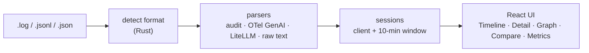

<div align="center">

# ThreadlineLM

**Visor offline de agentes LLM (portable, ~5 MB). Convierte logs compatibles con OpenAI, de LiteLLM y de OpenTelemetry en timelines visuales y grafos de llamadas a herramientas, 100% en local.**

[English](README.md) | **Español** | [Português](README.pt.md) | [Français](README.fr.md) | [简体中文](README.zh.md)

[](https://github.com/aralde/ThreadlineLM/releases/latest)
[](https://github.com/aralde/ThreadlineLM/releases)
[](LICENSE)
[](https://tauri.app)
[](#descarga)
[](https://github.com/aralde/ThreadlineLM/stargazers)

[**Descarga**](#descarga) · [Funciones](#funciones) · [Formatos soportados](#formatos-soportados) · [Compilar desde el código fuente](#compilar-desde-el-código-fuente)

<a href="docs/media/demo.mp4"></a>

<sub>La demo usa datos sintéticos. Haz clic en la animación para ver el video en resolución completa.</sub>

</div>

Cuando la ejecución de un agente sale mal, la evidencia está en un log lleno de JSON: requests, respuestas, llamadas a herramientas, chunks de streaming, reintentos. ThreadlineLM es una app de escritorio que convierte ese archivo en un timeline legible, la conversación reconstruida de cada sesión y un grafo de cada llamada a herramienta. Arrastra el archivo a la ventana. Nada sale de tu máquina.

Lee **logs de auditoría compatibles con OpenAI**, **spans GenAI de OpenTelemetry** y logs de **LiteLLM**. El formato se detecta por el contenido, así que la extensión del archivo no importa.

Si te ahorra una sesión de debugging, una ⭐ ayuda a que otras personas lo encuentren.

## Descarga

Baja la última versión desde **[Releases](https://github.com/aralde/ThreadlineLM/releases/latest)**:

| Plataforma | Archivo |
|---|---|
| Windows | `ThreadlineLM_<version>_x64-setup.exe` (instalador), `.msi` o `_x64-portable.exe` (sin instalación) |
| macOS (Apple Silicon) | `ThreadlineLM_<version>_aarch64.dmg` |
| macOS (Intel) | `ThreadlineLM_<version>_x64.dmg` |
| Linux | `.AppImage`, `.deb` o `.rpm` |

Después arrastra cualquier archivo de [`inputExample/`](inputExample) a la ventana para verlo en acción.

> [!NOTE]
> Los binarios todavía no están firmados. En Windows, SmartScreen puede mostrar una advertencia: elige **Más información → Ejecutar de todas formas**. En macOS, ejecuta `xattr -dr com.apple.quarantine /Applications/ThreadlineLM.app` una vez después de instalar.

## Compilar desde el código fuente

Requisitos: Node 20+, pnpm 10+, un toolchain estable de Rust (`rustup`) y las [dependencias de sistema de Tauri](https://tauri.app/start/prerequisites/) para tu sistema operativo (en Windows, WebView2 normalmente ya viene instalado).

```bash
git clone https://github.com/aralde/ThreadlineLM
cd ThreadlineLM
pnpm install
pnpm tauri dev
```

Luego arrastra `inputExample/audit.log` a la ventana. Deberías ver 9 llamadas en Timeline, el chat reconstruido en Detail, un grafo de usuario / asistente / llamadas a herramientas y la latencia p50/p95 en Metrics.

## Funciones

- **Reconstruye la conversación.** Las llamadas se agrupan en sesiones y se reproducen como un chat, incluyendo llamadas a herramientas, sus resultados y el contenido de razonamiento (chain-of-thought) cuando el proveedor lo devuelve.
- **Sigue las llamadas a herramientas como un grafo.** Cada sesión se convierte en un grafo de flujo con nodos de usuario, asistente y llamadas a herramientas, así los bucles y los callejones sin salida se ven de un vistazo.
- **Mira una ejecución en vivo.** Sigue un log mientras el agente todavía escribe en él; la vista vuelve a parsear cada vez que el archivo cambia (lo revisa cada 500 ms).
- **Compara dos llamadas.** Pon requests y respuestas lado a lado para ver qué cambió entre una ejecución que funciona y una que falla.
- **Sabe cuánto costó.** Percentiles de latencia (p50/p95/p99), conteo de tokens, costo estimado y cantidad de llamadas por proveedor y modelo.
- **Privado por diseño.** 100% local y en memoria. Sin llamadas de red, sin telemetría, sin cuenta. Seguro para logs con datos de clientes o secretos.
- **Busca y exporta.** Búsqueda difusa entre llamadas; exporta una sesión a Markdown para un reporte de bug o un postmortem.

Atajos: `Ctrl+1..5` cambia entre Timeline, Detail, Graph, Compare y Metrics.

## Formatos soportados

`inputExample/` tiene un archivo sintético por formato, así cada parser se puede probar sin trazas reales:

| Formato | Archivo de ejemplo | Eventos |
|---|---|---|
| JSONL de auditoría compatible con OpenAI: llamadas a herramientas, stream SSE, razonamiento, `tool_use` de Anthropic, un error 429 | `audit.log` | 9 |
| Los mismos registros de auditoría como un array JSON | `audit-array.json` | 3 |
| Spans GenAI de OpenTelemetry, atributos planos, uno por línea (los spans que no son GenAI se ignoran) | `otel-genai-spans.jsonl` | 3 |
| Envelope de exportación OTLP/JSON (`resourceSpans`) con atributos KeyValue | `otel-genai-otlp.json` | 2 |
| `StandardLoggingPayload` de LiteLLM: respuesta en streaming, uso de herramientas, embedding, fallo | `litellm.jsonl` | 5 |
| Log de proxy en texto plano con JSON de auditoría embebido en algunas líneas | `proxy-raw.log` | 2 |

Limitación: el JSON tiene que tener un registro por línea (o ser un envelope OTLP en una sola línea). El JSON formateado en varias líneas todavía no se detecta.

## Cómo funciona



El parseo y la agrupación en sesiones corren en el backend de Rust; el frontend de React recibe resultados tipados por IPC de Tauri (el puente entre el proceso de Rust y la web view). Stack: Tauri 2, React, TypeScript, Vite, Tailwind v4.

```
src/                       React + TS frontend
  components/              one view per tab (Timeline, Detail, Graph, Compare, Metrics)
  state/store.ts           Zustand store
  ipc.ts                   typed wrappers around invoke()
src-tauri/src/
  parser/                  format detection and one parser per format
  session.rs               grouping by client + 10-min window
  export.rs                session_to_markdown
  commands.rs              #[tauri::command] exposed to the frontend
inputExample/              one synthetic example per supported format
```

## Tests

```bash
cd src-tauri
cargo test
```

Los tests `parses_input_example` y `example_*` parsean cada archivo de `inputExample/` y verifican la detección de formato y la cantidad de eventos.

## Build

```bash
pnpm tauri build
```

Genera instaladores por plataforma en `src-tauri/target/release/bundle/` (Windows MSI/NSIS, macOS DMG, Linux AppImage/deb).

| Comando | Resultado |
|---|---|
| `pnpm tauri build` | `.exe` + instalador NSIS + `.msi` |
| `pnpm tauri build --no-bundle` | solo el `.exe` portable (~10–15 MB, `src-tauri/target/release/threadlinelm.exe`) |
| `pnpm tauri build --bundles nsis` | solo el instalador NSIS |

<details>
<summary><b>Build de Windows totalmente portable (sin WebView2 del sistema)</b></summary>

El `.exe` usa Microsoft Edge WebView2 como motor de renderizado. Viene con Windows 11; en versiones más viejas de Windows 10 se descarga en el primer arranque si falta.

Para no depender del WebView2 del sistema ni de internet (≈ +150 MB), incluye el Fixed Version Runtime. Descárgalo de [aka.ms/webview2](https://developer.microsoft.com/microsoft-edge/webview2/) y agrégalo a `src-tauri/tauri.conf.json`:

```json
"bundle": {
  "windows": {
    "webviewInstallMode": {
      "type": "fixedRuntime",
      "path": "path/to/Microsoft.WebView2.FixedVersionRuntime.x.y.z.x64"
    }
  }
}
```

Distribuye **la carpeta completa**, no solo el `.exe`, porque WebView2 va al lado.

</details>

<details>
<summary><b>Releases y compilación cruzada</b></summary>

Compilar para Windows, macOS y Linux desde una sola máquina requiere el toolchain nativo de cada destino, así que los releases se compilan en CI. Al hacer push de un tag `v*` se dispara [`.github/workflows/release.yml`](.github/workflows/release.yml), que compila en `windows-latest`, `macos-latest` (Apple Silicon e Intel) y `ubuntu-22.04`, y adjunta los instaladores y un `.exe` portable de Windows a un borrador de GitHub Release para revisarlo antes de publicar.

```bash
git tag -a v0.3.0 -m "v0.3.0" && git push origin v0.3.0
```

</details>

## Estado

Temprano: v0.3.0. Los formatos y las vistas son lo bastante estables para el debugging diario; espera algunas asperezas con formas de log poco comunes. Si algún log tuyo no se detecta, un issue con una muestra anonimizada es el reporte de bug más útil.

## Contribuir

Issues y PRs son bienvenidos en <https://github.com/aralde/ThreadlineLM/issues>. Los parsers de formatos nuevos son especialmente bienvenidos: agrega una muestra sintética en `inputExample/` y un test junto a los tests `example_*` existentes.

## Licencia

Apache License 2.0. Ver [LICENSE](LICENSE) y [NOTICE](NOTICE).
