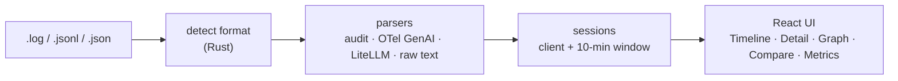

<div align="center">

# ThreadlineLM

**Visualiseur hors ligne pour agents LLM (portable, ~5 Mo). Transforme les logs compatibles OpenAI, LiteLLM et OpenTelemetry en timelines visuelles et en graphes d'appels d'outils, 100 % en local.**

[English](README.md) | [Español](README.es.md) | [Português](README.pt.md) | **Français** | [简体中文](README.zh.md)

[](https://github.com/aralde/ThreadlineLM/releases/latest)
[](https://github.com/aralde/ThreadlineLM/releases)
[](LICENSE)
[](https://tauri.app)
[](#téléchargement)
[](https://github.com/aralde/ThreadlineLM/stargazers)

[**Téléchargement**](#téléchargement) · [Fonctionnalités](#fonctionnalités) · [Formats pris en charge](#formats-pris-en-charge) · [Compiler depuis les sources](#compiler-depuis-les-sources)

<a href="docs/media/demo.mp4"></a>

<sub>La démo utilise des données synthétiques. Cliquez sur l'animation pour voir la vidéo en pleine résolution.</sub>

</div>

Quand l'exécution d'un agent tourne mal, les preuves sont dans un log rempli de JSON : requêtes, réponses, appels d'outils, chunks de streaming, nouvelles tentatives. ThreadlineLM est une application de bureau qui transforme ce fichier en une timeline lisible, la conversation reconstruite de chaque session et un graphe de chaque appel d'outil. Déposez le fichier sur la fenêtre. Rien ne quitte votre machine.

Lit les **logs d'audit compatibles OpenAI**, les **spans GenAI d'OpenTelemetry** et les logs **LiteLLM**. Le format est détecté à partir du contenu, l'extension du fichier n'a donc pas d'importance.

S'il vous fait gagner une session de débogage, une ⭐ aide d'autres personnes à le trouver.

## Téléchargement

Récupérez la dernière version depuis **[Releases](https://github.com/aralde/ThreadlineLM/releases/latest)** :

| Plateforme | Fichier |
|---|---|
| Windows | `ThreadlineLM_<version>_x64-setup.exe` (installateur), `.msi` ou `_x64-portable.exe` (sans installation) |
| macOS (Apple Silicon) | `ThreadlineLM_<version>_aarch64.dmg` |
| macOS (Intel) | `ThreadlineLM_<version>_x64.dmg` |
| Linux | `.AppImage`, `.deb` ou `.rpm` |

Déposez ensuite n'importe quel fichier de [`inputExample/`](inputExample) sur la fenêtre pour le voir en action.

> [!NOTE]
> Les binaires ne sont pas encore signés. Sous Windows, SmartScreen peut afficher un avertissement : choisissez **Informations complémentaires → Exécuter quand même**. Sous macOS, lancez `xattr -dr com.apple.quarantine /Applications/ThreadlineLM.app` une fois après l'installation.

## Compiler depuis les sources

Prérequis : Node 20+, pnpm 10+, une toolchain Rust stable (`rustup`) et les [dépendances système de Tauri](https://tauri.app/start/prerequisites/) pour votre OS (sous Windows, WebView2 est généralement déjà installé).

```bash
git clone https://github.com/aralde/ThreadlineLM
cd ThreadlineLM
pnpm install
pnpm tauri dev
```

Déposez ensuite `inputExample/audit.log` sur la fenêtre. Vous devriez voir 9 appels dans Timeline, le chat reconstruit dans Detail, un graphe utilisateur / assistant / appels d'outils et la latence p50/p95 dans Metrics.

## Fonctionnalités

- **Reconstruire la conversation.** Les appels sont regroupés en sessions et rejoués sous forme de chat, avec les appels d'outils, leurs résultats et le contenu de raisonnement (chain-of-thought) quand le fournisseur le renvoie.
- **Suivre les appels d'outils sous forme de graphe.** Chaque session devient un graphe de flux de nœuds utilisateur, assistant et appels d'outils, ce qui rend les boucles et les impasses visibles d'un coup d'œil.
- **Suivre une exécution en direct.** Suivez un log pendant que l'agent y écrit encore ; la vue est re-parsée à chaque modification du fichier (vérifié toutes les 500 ms).
- **Comparer deux appels.** Mettez requêtes et réponses côte à côte pour voir ce qui a changé entre une exécution qui fonctionne et une qui échoue.
- **Savoir ce que ça a coûté.** Percentiles de latence (p50/p95/p99), nombre de tokens, coût estimé et nombre d'appels par fournisseur et par modèle.
- **Privé par conception.** 100 % local et en mémoire. Aucun appel réseau, aucune télémétrie, aucun compte. Sûr pour les logs contenant des données clients ou des secrets.
- **Rechercher et exporter.** Recherche approximative dans les appels ; exportez une session en Markdown pour un rapport de bug ou un postmortem.

Raccourcis : `Ctrl+1..5` bascule entre Timeline, Detail, Graph, Compare et Metrics.

## Formats pris en charge

`inputExample/` contient un fichier synthétique par format, pour que chaque parser puisse être testé sans traces réelles :

| Format | Fichier d'exemple | Événements |
|---|---|---|
| JSONL d'audit compatible OpenAI : appels d'outils, stream SSE, raisonnement, `tool_use` d'Anthropic, une erreur 429 | `audit.log` | 9 |
| Les mêmes enregistrements d'audit sous forme de tableau JSON | `audit-array.json` | 3 |
| Spans GenAI d'OpenTelemetry, attributs simples, un par ligne (les spans non GenAI sont ignorés) | `otel-genai-spans.jsonl` | 3 |
| Enveloppe d'export OTLP/JSON (`resourceSpans`) avec des attributs KeyValue | `otel-genai-otlp.json` | 2 |
| `StandardLoggingPayload` de LiteLLM : réponse en streaming, utilisation d'outils, embedding, échec | `litellm.jsonl` | 5 |
| Log de proxy en texte brut avec du JSON d'audit intégré dans certaines lignes | `proxy-raw.log` | 2 |

Limitation : le JSON doit contenir un enregistrement par ligne (ou être une enveloppe OTLP sur une seule ligne). Le JSON indenté sur plusieurs lignes n'est pas encore détecté.

## Fonctionnement



Le parsing et le regroupement en sessions s'exécutent dans le backend Rust ; le frontend React reçoit des résultats typés via l'IPC de Tauri (le pont entre le processus Rust et la web view). Stack : Tauri 2, React, TypeScript, Vite, Tailwind v4.

```
src/                       React + TS frontend
  components/              one view per tab (Timeline, Detail, Graph, Compare, Metrics)
  state/store.ts           Zustand store
  ipc.ts                   typed wrappers around invoke()
src-tauri/src/
  parser/                  format detection and one parser per format
  session.rs               grouping by client + 10-min window
  export.rs                session_to_markdown
  commands.rs              #[tauri::command] exposed to the frontend
inputExample/              one synthetic example per supported format
```

## Tests

```bash
cd src-tauri
cargo test
```

Les tests `parses_input_example` et `example_*` parsent chaque fichier de `inputExample/` et vérifient la détection du format et le nombre d'événements.

## Build

```bash
pnpm tauri build
```

Produit des installateurs par plateforme dans `src-tauri/target/release/bundle/` (Windows MSI/NSIS, macOS DMG, Linux AppImage/deb).

| Commande | Résultat |
|---|---|
| `pnpm tauri build` | `.exe` + installateur NSIS + `.msi` |
| `pnpm tauri build --no-bundle` | `.exe` portable seul (~10–15 Mo, `src-tauri/target/release/threadlinelm.exe`) |
| `pnpm tauri build --bundles nsis` | installateur NSIS seul |

<details>
<summary><b>Build Windows entièrement portable (sans le WebView2 du système)</b></summary>

Le `.exe` utilise Microsoft Edge WebView2 comme moteur de rendu. Il est fourni avec Windows 11 ; sur les anciennes versions de Windows 10, il est téléchargé au premier lancement s'il manque.

Pour ne dépendre ni du WebView2 du système ni d'internet (≈ +150 Mo), intégrez le Fixed Version Runtime. Téléchargez-le depuis [aka.ms/webview2](https://developer.microsoft.com/microsoft-edge/webview2/) et ajoutez-le dans `src-tauri/tauri.conf.json` :

```json
"bundle": {
  "windows": {
    "webviewInstallMode": {
      "type": "fixedRuntime",
      "path": "path/to/Microsoft.WebView2.FixedVersionRuntime.x.y.z.x64"
    }
  }
}
```

Distribuez **le dossier entier**, pas seulement le `.exe`, car WebView2 se trouve à côté.

</details>

<details>
<summary><b>Releases et compilation croisée</b></summary>

Compiler pour Windows, macOS et Linux depuis une seule machine demande la toolchain native de chaque cible, donc les releases sont compilées en CI. Pousser un tag `v*` déclenche [`.github/workflows/release.yml`](.github/workflows/release.yml), qui compile sur `windows-latest`, `macos-latest` (Apple Silicon et Intel) et `ubuntu-22.04`, puis attache les installateurs et un `.exe` portable Windows à un brouillon de GitHub Release, à relire avant publication.

```bash
git tag -a v0.3.0 -m "v0.3.0" && git push origin v0.3.0
```

</details>

## État

Version précoce : v0.3.0. Les formats et les vues sont assez stables pour le débogage au quotidien ; attendez-vous à quelques imperfections avec des formes de log inhabituelles. Si l'un de vos logs n'est pas détecté, une issue avec un échantillon anonymisé est le rapport de bug le plus utile.

## Contribuer

Les issues et les PR sont les bienvenues sur <https://github.com/aralde/ThreadlineLM/issues>. Les parsers pour de nouveaux formats sont particulièrement bienvenus : ajoutez un échantillon synthétique dans `inputExample/` et un test à côté des tests `example_*` existants.

## Licence

Apache License 2.0. Voir [LICENSE](LICENSE) et [NOTICE](NOTICE).
