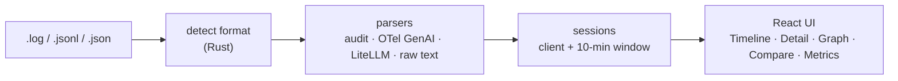

<div align="center">

# ThreadlineLM

**Visualizador offline de agentes LLM (portátil, ~5 MB). Transforma logs compatíveis com OpenAI, do LiteLLM e do OpenTelemetry em timelines visuais e grafos de chamadas de ferramentas, 100% local.**

[English](README.md) | [Español](README.es.md) | **Português** | [Français](README.fr.md) | [简体中文](README.zh.md)

[](https://github.com/aralde/ThreadlineLM/releases/latest)
[](https://github.com/aralde/ThreadlineLM/releases)
[](LICENSE)
[](https://tauri.app)
[](#download)
[](https://github.com/aralde/ThreadlineLM/stargazers)

[**Download**](#download) · [Recursos](#recursos) · [Formatos suportados](#formatos-suportados) · [Compilar a partir do código-fonte](#compilar-a-partir-do-código-fonte)

<a href="docs/media/demo.mp4"></a>

<sub>A demo usa dados sintéticos. Clique na animação para ver o vídeo em resolução completa.</sub>

</div>

Quando a execução de um agente dá errado, a evidência está num log cheio de JSON: requisições, respostas, chamadas de ferramentas, chunks de streaming, novas tentativas. O ThreadlineLM é um app desktop que transforma esse arquivo numa timeline legível, na conversa reconstruída de cada sessão e num grafo de cada chamada de ferramenta. Arraste o arquivo para a janela. Nada sai da sua máquina.

Lê **logs de auditoria compatíveis com OpenAI**, **spans GenAI do OpenTelemetry** e logs do **LiteLLM**. O formato é detectado pelo conteúdo, então a extensão do arquivo não importa.

Se ele te poupar uma sessão de debugging, uma ⭐ ajuda outras pessoas a encontrá-lo.

## Download

Baixe a versão mais recente em **[Releases](https://github.com/aralde/ThreadlineLM/releases/latest)**:

| Plataforma | Arquivo |
|---|---|
| Windows | `ThreadlineLM_<version>_x64-setup.exe` (instalador), `.msi` ou `_x64-portable.exe` (sem instalação) |
| macOS (Apple Silicon) | `ThreadlineLM_<version>_aarch64.dmg` |
| macOS (Intel) | `ThreadlineLM_<version>_x64.dmg` |
| Linux | `.AppImage`, `.deb` ou `.rpm` |

Depois arraste qualquer arquivo de [`inputExample/`](inputExample) para a janela para vê-lo em ação.

> [!NOTE]
> Os binários ainda não são assinados. No Windows, o SmartScreen pode exibir um aviso: escolha **Mais informações → Executar assim mesmo**. No macOS, rode `xattr -dr com.apple.quarantine /Applications/ThreadlineLM.app` uma vez depois de instalar.

## Compilar a partir do código-fonte

Pré-requisitos: Node 20+, pnpm 10+, um toolchain estável de Rust (`rustup`) e as [dependências de sistema do Tauri](https://tauri.app/start/prerequisites/) para o seu sistema operacional (no Windows, o WebView2 normalmente já vem instalado).

```bash
git clone https://github.com/aralde/ThreadlineLM
cd ThreadlineLM
pnpm install
pnpm tauri dev
```

Depois arraste `inputExample/audit.log` para a janela. Você deve ver 9 chamadas na Timeline, o chat reconstruído em Detail, um grafo de usuário / assistente / chamadas de ferramentas e a latência p50/p95 em Metrics.

## Recursos

- **Reconstrói a conversa.** As chamadas são agrupadas em sessões e reproduzidas como um chat, incluindo chamadas de ferramentas, seus resultados e o conteúdo de raciocínio (chain-of-thought) quando o provedor o retorna.
- **Acompanhe as chamadas de ferramentas como um grafo.** Cada sessão vira um grafo de fluxo com nós de usuário, assistente e chamadas de ferramentas, então loops e becos sem saída aparecem de relance.
- **Acompanhe uma execução ao vivo.** Siga um log enquanto o agente ainda escreve nele; a visualização é refeita sempre que o arquivo muda (verificado a cada 500 ms).
- **Compare duas chamadas.** Coloque requisições e respostas lado a lado para ver o que mudou entre uma execução que funciona e uma que falha.
- **Saiba quanto custou.** Percentis de latência (p50/p95/p99), contagem de tokens, custo estimado e número de chamadas por provedor e modelo.
- **Privado por design.** 100% local e em memória. Sem chamadas de rede, sem telemetria, sem conta. Seguro para logs com dados de clientes ou segredos.
- **Busque e exporte.** Busca aproximada entre chamadas; exporte uma sessão para Markdown para um relatório de bug ou um postmortem.

Atalhos: `Ctrl+1..5` alterna entre Timeline, Detail, Graph, Compare e Metrics.

## Formatos suportados

`inputExample/` tem um arquivo sintético por formato, então cada parser pode ser testado sem traces reais:

| Formato | Arquivo de exemplo | Eventos |
|---|---|---|
| JSONL de auditoria compatível com OpenAI: chamadas de ferramentas, stream SSE, raciocínio, `tool_use` da Anthropic, um erro 429 | `audit.log` | 9 |
| Os mesmos registros de auditoria como um array JSON | `audit-array.json` | 3 |
| Spans GenAI do OpenTelemetry, atributos simples, um por linha (spans que não são GenAI são ignorados) | `otel-genai-spans.jsonl` | 3 |
| Envelope de exportação OTLP/JSON (`resourceSpans`) com atributos KeyValue | `otel-genai-otlp.json` | 2 |
| `StandardLoggingPayload` do LiteLLM: resposta em streaming, uso de ferramentas, embedding, falha | `litellm.jsonl` | 5 |
| Log de proxy em texto puro com JSON de auditoria embutido em algumas linhas | `proxy-raw.log` | 2 |

Limitação: o JSON precisa ter um registro por linha (ou ser um envelope OTLP numa única linha). JSON formatado em várias linhas ainda não é detectado.

## Como funciona



O parsing e o agrupamento em sessões rodam no backend em Rust; o frontend em React recebe resultados tipados via IPC do Tauri (a ponte entre o processo Rust e a web view). Stack: Tauri 2, React, TypeScript, Vite, Tailwind v4.

```
src/                       React + TS frontend
  components/              one view per tab (Timeline, Detail, Graph, Compare, Metrics)
  state/store.ts           Zustand store
  ipc.ts                   typed wrappers around invoke()
src-tauri/src/
  parser/                  format detection and one parser per format
  session.rs               grouping by client + 10-min window
  export.rs                session_to_markdown
  commands.rs              #[tauri::command] exposed to the frontend
inputExample/              one synthetic example per supported format
```

## Testes

```bash
cd src-tauri
cargo test
```

Os testes `parses_input_example` e `example_*` fazem o parsing de cada arquivo em `inputExample/` e verificam a detecção de formato e a contagem de eventos.

## Build

```bash
pnpm tauri build
```

Gera instaladores por plataforma em `src-tauri/target/release/bundle/` (Windows MSI/NSIS, macOS DMG, Linux AppImage/deb).

| Comando | Saída |
|---|---|
| `pnpm tauri build` | `.exe` + instalador NSIS + `.msi` |
| `pnpm tauri build --no-bundle` | só o `.exe` portátil (~10–15 MB, `src-tauri/target/release/threadlinelm.exe`) |
| `pnpm tauri build --bundles nsis` | só o instalador NSIS |

<details>
<summary><b>Build do Windows totalmente portátil (sem o WebView2 do sistema)</b></summary>

O `.exe` usa o Microsoft Edge WebView2 como motor de renderização. Ele vem com o Windows 11; em versões mais antigas do Windows 10, é baixado na primeira execução se estiver faltando.

Para não depender do WebView2 do sistema nem da internet (≈ +150 MB), inclua o Fixed Version Runtime. Baixe-o em [aka.ms/webview2](https://developer.microsoft.com/microsoft-edge/webview2/) e adicione em `src-tauri/tauri.conf.json`:

```json
"bundle": {
  "windows": {
    "webviewInstallMode": {
      "type": "fixedRuntime",
      "path": "path/to/Microsoft.WebView2.FixedVersionRuntime.x.y.z.x64"
    }
  }
}
```

Distribua **a pasta inteira**, não só o `.exe`, porque o WebView2 fica ao lado dele.

</details>

<details>
<summary><b>Releases e compilação cruzada</b></summary>

Compilar para Windows, macOS e Linux a partir de uma única máquina exige o toolchain nativo de cada destino, então os releases são compilados no CI. Um push de uma tag `v*` dispara [`.github/workflows/release.yml`](.github/workflows/release.yml), que compila em `windows-latest`, `macos-latest` (Apple Silicon e Intel) e `ubuntu-22.04`, e anexa os instaladores e um `.exe` portátil do Windows a um rascunho de GitHub Release para revisão antes da publicação.

```bash
git tag -a v0.3.0 -m "v0.3.0" && git push origin v0.3.0
```

</details>

## Status

Inicial: v0.3.0. Os formatos e as visualizações são estáveis o bastante para o debugging do dia a dia; espere algumas arestas com formatos de log incomuns. Se algum log seu não for detectado, uma issue com uma amostra anonimizada é o relatório de bug mais útil.

## Contribuindo

Issues e PRs são bem-vindos em <https://github.com/aralde/ThreadlineLM/issues>. Parsers para novos formatos são especialmente bem-vindos: adicione uma amostra sintética em `inputExample/` e um teste ao lado dos testes `example_*` existentes.

## Licença

Apache License 2.0. Veja [LICENSE](LICENSE) e [NOTICE](NOTICE).
