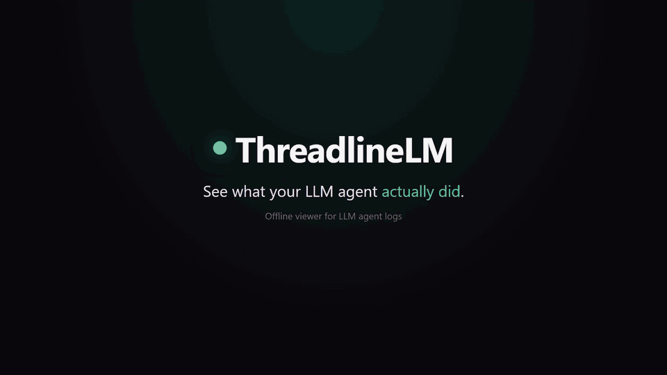
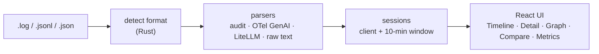

<div align="center">

# ThreadlineLM

**离线 LLM 智能体日志查看器（便携版，约 5 MB）。将 OpenAI 兼容、LiteLLM 和 OpenTelemetry 日志解析为可视化时间线和工具调用图，100% 本地运行。**

[English](README.md) | [Español](README.es.md) | [Português](README.pt.md) | [Français](README.fr.md) | **简体中文**

[](https://github.com/aralde/ThreadlineLM/releases/latest)
[](https://github.com/aralde/ThreadlineLM/releases)
[](LICENSE)
[](https://tauri.app)
[](#下载)
[](https://github.com/aralde/ThreadlineLM/stargazers)

[**下载**](#下载) · [功能](#功能) · [支持的格式](#支持的格式) · [从源码构建](#从源码构建)

<a href="docs/media/demo.mp4"></a>

<sub>演示使用的是合成数据。点击动画可查看全分辨率视频。</sub>

</div>

当智能体运行出错时，证据就在一份充满 JSON 的日志里：请求、响应、工具调用、流式分块、重试。ThreadlineLM 是一款桌面应用，能把这个文件变成易读的时间线、每个会话重建后的对话，以及每次工具调用的关系图。把文件拖到窗口上即可。任何数据都不会离开你的电脑。

支持读取 **OpenAI 兼容的审计日志**、**OpenTelemetry GenAI span** 和 **LiteLLM** 日志。格式根据文件内容自动识别，因此文件扩展名无关紧要。

如果它帮你省下了一次调试，点一个 ⭐ 能帮助更多人发现它。

## 下载

从 **[Releases](https://github.com/aralde/ThreadlineLM/releases/latest)** 获取最新版本：

| 平台 | 文件 |
|---|---|
| Windows | `ThreadlineLM_<version>_x64-setup.exe`（安装程序）、`.msi`，或 `_x64-portable.exe`（免安装） |
| macOS (Apple Silicon) | `ThreadlineLM_<version>_aarch64.dmg` |
| macOS (Intel) | `ThreadlineLM_<version>_x64.dmg` |
| Linux | `.AppImage`、`.deb` 或 `.rpm` |

然后把 [`inputExample/`](inputExample) 中的任意文件拖到窗口上，看看实际效果。

> [!NOTE]
> 二进制文件尚未进行代码签名。在 Windows 上，SmartScreen 可能会发出警告：选择 **更多信息 → 仍要运行**。在 macOS 上，安装后运行一次 `xattr -dr com.apple.quarantine /Applications/ThreadlineLM.app`。

## 从源码构建

前置条件：Node 20+、pnpm 10+、稳定版 Rust 工具链（`rustup`），以及你所用操作系统的 [Tauri 系统依赖](https://tauri.app/start/prerequisites/)（Windows 通常已预装 WebView2）。

```bash
git clone https://github.com/aralde/ThreadlineLM
cd ThreadlineLM
pnpm install
pnpm tauri dev
```

然后把 `inputExample/audit.log` 拖到窗口上。你应该会在 Timeline 中看到 9 次调用，在 Detail 中看到重建的对话，看到一张用户 / 助手 / 工具调用关系图，并在 Metrics 中看到 p50/p95 延迟。

## 功能

- **重建对话。** 调用按会话分组并以聊天形式回放，包括工具调用、工具结果，以及提供商返回的推理（chain-of-thought）内容。
- **以图的形式追踪工具调用。** 每个会话都会变成由用户、助手和工具调用节点组成的流程图，循环和死胡同一目了然。
- **实时查看运行。** 在智能体仍在写入日志时跟踪它；文件每次变化都会重新解析（每 500 ms 轮询一次）。
- **对比两次调用。** 把请求和响应并排放置，查看正常运行和失败运行之间有什么不同。
- **了解花了多少钱。** 延迟百分位（p50/p95/p99）、token 数、估算成本，以及按提供商和模型统计的调用次数。
- **隐私优先。** 100% 本地、仅在内存中处理。没有网络请求，没有遥测，无需账号。适用于包含客户数据或密钥的日志。
- **搜索与导出。** 在调用之间进行模糊搜索；把会话导出为 Markdown，用于 bug 报告或事后复盘。

快捷键：`Ctrl+1..5` 在 Timeline、Detail、Graph、Compare 和 Metrics 之间切换。

## 支持的格式

`inputExample/` 为每种格式提供一个合成示例文件，无需真实追踪数据即可试用每个解析器：

| 格式 | 示例文件 | 事件数 |
|---|---|---|
| OpenAI 兼容的审计 JSONL：工具调用、SSE 流、推理、Anthropic `tool_use`、一次 429 错误 | `audit.log` | 9 |
| 以 JSON 数组形式保存的相同审计记录 | `audit-array.json` | 3 |
| OpenTelemetry GenAI span，普通属性，每行一个（非 GenAI span 会被跳过） | `otel-genai-spans.jsonl` | 3 |
| 带 KeyValue 属性的 OTLP/JSON 导出信封（`resourceSpans`） | `otel-genai-otlp.json` | 2 |
| LiteLLM `StandardLoggingPayload`：流式响应、工具使用、embedding、失败 | `litellm.jsonl` | 5 |
| 部分行内嵌审计 JSON 的纯文本代理日志 | `proxy-raw.log` | 2 |

限制：JSON 必须每行一条记录（或是单行的 OTLP 信封）。暂不支持多行格式化（pretty-printed）的 JSON。

## 工作原理



解析和会话分组在 Rust 后端运行；React 前端通过 Tauri IPC（Rust 进程与 web view 之间的桥梁）获取带类型的结果。技术栈：Tauri 2、React、TypeScript、Vite、Tailwind v4。

```
src/                       React + TS frontend
  components/              one view per tab (Timeline, Detail, Graph, Compare, Metrics)
  state/store.ts           Zustand store
  ipc.ts                   typed wrappers around invoke()
src-tauri/src/
  parser/                  format detection and one parser per format
  session.rs               grouping by client + 10-min window
  export.rs                session_to_markdown
  commands.rs              #[tauri::command] exposed to the frontend
inputExample/              one synthetic example per supported format
```

## 测试

```bash
cd src-tauri
cargo test
```

`parses_input_example` 和 `example_*` 测试会解析 `inputExample/` 中的每个文件，并检查格式识别和事件数量。

## 构建

```bash
pnpm tauri build
```

在 `src-tauri/target/release/bundle/` 下生成各平台的安装包（Windows MSI/NSIS、macOS DMG、Linux AppImage/deb）。

| 命令 | 输出 |
|---|---|
| `pnpm tauri build` | `.exe` + NSIS 安装程序 + `.msi` |
| `pnpm tauri build --no-bundle` | 仅便携版 `.exe`（约 10–15 MB，`src-tauri/target/release/threadlinelm.exe`） |
| `pnpm tauri build --bundles nsis` | 仅 NSIS 安装程序 |

<details>
<summary><b>完全便携的 Windows 构建（不依赖系统 WebView2）</b></summary>

`.exe` 使用 Microsoft Edge WebView2 作为渲染引擎。Windows 11 自带 WebView2；在较旧的 Windows 10 版本上，如果缺失，会在首次启动时下载。

若不想依赖系统 WebView2 或网络（约 +150 MB），可以内嵌 Fixed Version Runtime。从 [aka.ms/webview2](https://developer.microsoft.com/microsoft-edge/webview2/) 下载，并添加到 `src-tauri/tauri.conf.json`：

```json
"bundle": {
  "windows": {
    "webviewInstallMode": {
      "type": "fixedRuntime",
      "path": "path/to/Microsoft.WebView2.FixedVersionRuntime.x.y.z.x64"
    }
  }
}
```

请分发**整个文件夹**，而不只是 `.exe`，因为 WebView2 就放在它旁边。

</details>

<details>
<summary><b>发布与交叉编译</b></summary>

在一台机器上为 Windows、macOS 和 Linux 交叉构建需要各目标平台的原生工具链，因此发布版本在 CI 上构建。推送 `v*` 标签会触发 [`.github/workflows/release.yml`](.github/workflows/release.yml)，它在 `windows-latest`、`macos-latest`（Apple Silicon 和 Intel）以及 `ubuntu-22.04` 上构建，然后把安装包和一个 Windows 便携版 `.exe` 附加到 GitHub Release 草稿中，审核后再发布。

```bash
git tag -a v0.3.0 -m "v0.3.0" && git push origin v0.3.0
```

</details>

## 状态

早期版本：v0.3.0。格式和视图已足够稳定，可用于日常调试；遇到不常见的日志形态时可能还有些粗糙。如果你的日志无法被识别，附上一份脱敏样本的 issue 是最有用的 bug 报告。

## 参与贡献

欢迎在 <https://github.com/aralde/ThreadlineLM/issues> 提交 issue 和 PR。特别欢迎新格式的解析器：在 `inputExample/` 中添加一个合成样本，并在现有 `example_*` 测试旁边加一个测试。

## 许可证

Apache License 2.0。参见 [LICENSE](LICENSE) 和 [NOTICE](NOTICE)。
